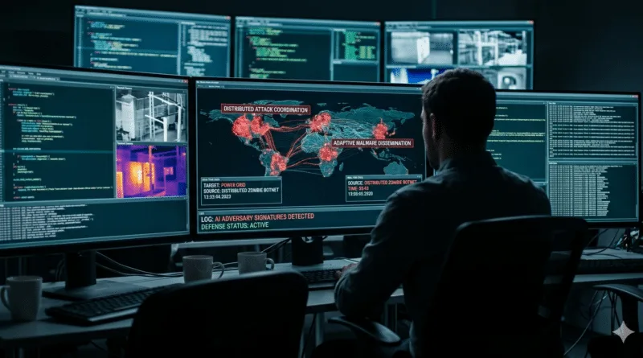
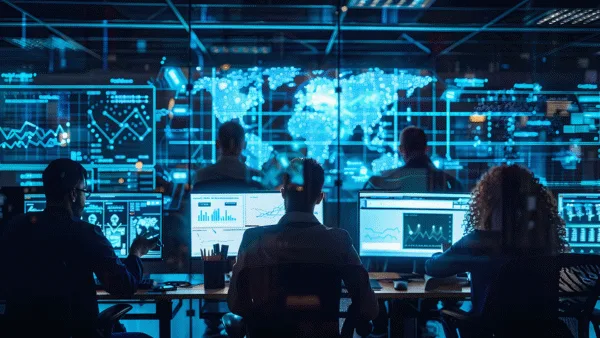
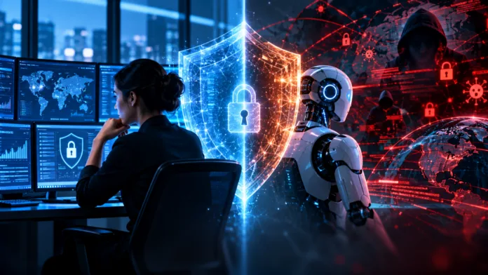

## Abstract

La inteligencia artificial está cambiando la economía de los ciberataques. No se trata únicamente de que los actores maliciosos dispongan de herramientas más sofisticadas, sino de que ahora pueden investigar más objetivos, automatizar tareas que antes exigían conocimientos especializados y reducir considerablemente el tiempo y los recursos necesarios para preparar una intrusión. La barrera de entrada disminuye mientras aumenta la capacidad de actuación de quienes ya disponían de experiencia y recursos.

Esta aceleración plantea un problema especialmente serio para las organizaciones: la velocidad con la que se descubren y explotan vulnerabilidades puede superar ampliamente su capacidad para identificarlas, evaluar el riesgo, probar las correcciones y desplegarlas sin afectar a sus servicios. En entornos industriales y otras infraestructuras críticas, el problema se agrava porque no siempre es posible aplicar un parche de inmediato. Una actualización puede exigir pruebas, validaciones del fabricante, ventanas de mantenimiento y garantías de que el cambio no interrumpirá un proceso esencial.

Los informes publicados por empresas como Google Threat Intelligence Group, Mandiant, Anthropic y Microsoft muestran que los actores maliciosos ya utilizan modelos de IA para acelerar distintas fases de sus campañas: reconocimiento, investigación técnica, desarrollo de herramientas, preparación de intrusiones, procesamiento de información y operaciones de influencia. Además, el uso de modelos modificados para sortear las restricciones de los asistentes generalistas añade nuevas posibilidades a este escenario.

El contexto geopolítico introduce otra dimensión. Algunos Estados y grupos vinculados a sus intereses pueden utilizar estas capacidades para aumentar la presión sobre otros países, afectar a servicios esenciales, erosionar la confianza en las instituciones y amplificar el impacto de los incidentes mediante campañas de propaganda y desinformación. Ante este escenario, las organizaciones tendrán que revisar sus procedimientos, adaptar sus procesos de negocio y reforzar sus capacidades de defensa y recuperación. La resiliencia será determinante, pero también lo será aprender a defenderse con inteligencia artificial. La cuestión ya no es si debemos incorporar estas capacidades, sino cómo hacerlo antes de que la diferencia de velocidad entre ataque y defensa resulte insostenible.

---

## 1. El verdadero cambio: atacar cuesta menos y exige menos tiempo

Durante años, la capacidad para desarrollar y ejecutar un ciberataque dependía de una combinación de conocimientos técnicos, tiempo, herramientas y recursos humanos. Encontrar un objetivo podía ser relativamente sencillo, pero comprender su arquitectura, identificar una debilidad aprovechable, adaptar las herramientas y conseguir acceso requería trabajo especializado. La experiencia del atacante y el número de personas disponibles imponían límites bastante claros a la cantidad de objetivos que podía investigar y atacar simultáneamente.

La inteligencia artificial está modificando esa ecuación. No necesita inventar una nueva técnica de explotación para cambiar las reglas del juego. Basta con que permita realizar en minutos tareas que antes requerían horas de investigación, automatizar procesos repetitivos o ayudar a un operador a resolver problemas técnicos que, sin asistencia, podrían quedar fuera de sus conocimientos. El efecto acumulado es importante: un mismo actor puede investigar más objetivos, probar más hipótesis y mantener más campañas en paralelo.

El cambio económico es tan relevante como el tecnológico. Si disminuye el coste de investigar una organización, preparar una campaña o adaptar una herramienta, también disminuye el umbral a partir del cual un objetivo resulta interesante. Ataques que antes no compensaban el esfuerzo pueden convertirse en oportunidades asumibles. Esto puede favorecer campañas más numerosas, dirigidas a organizaciones de menor tamaño o con menos recursos para defenderse, sin que el atacante tenga que renunciar a sus objetivos de mayor valor.

El informe de Anthropic de septiembre de 2026 describe precisamente esta evolución. La compañía documenta operaciones en las que distintos actores utilizaron Claude para automatizar tareas a lo largo de la cadena de ataque, desde el reconocimiento hasta la explotación y la extracción de información. En algunos casos, los operadores organizaron agentes que trabajaban en paralelo y mantenían el contexto de las campañas entre sesiones. La propia investigación advierte de que la IA no solo aporta velocidad: también amplía la cantidad de información que un actor puede procesar y la profundidad de las tareas que puede abordar.

Google Threat Intelligence Group y Mandiant también han observado el paso de un uso principalmente asistencial de los modelos a flujos de trabajo más autónomos. En su informe de septiembre de 2026 describen actores que incorporan herramientas de automatización para reconocer infraestructuras, validar vulnerabilidades y recopilar credenciales. En mayo, GTIG ya había documentado un caso en el que un actor utilizó un exploit de día cero que, según su evaluación, había sido desarrollado con ayuda de IA. No estamos hablando, por tanto, de una posibilidad teórica o de una demostración aislada en un laboratorio.

Conviene no confundir esta evolución con la aparición de atacantes completamente autónomos capaces de ejecutar cualquier operación sin supervisión. En muchas campañas, las personas siguen seleccionando los objetivos, decidiendo qué información interesa y revisando los resultados. Sin embargo, ya no necesitan intervenir en cada tarea. La IA puede asumir una parte creciente del trabajo y permitir que un operador supervise procesos que antes habrían exigido un equipo completo.

Esta reducción de costes y tiempos debería cambiar nuestra forma de evaluar el riesgo. No podemos seguir pensando únicamente en la sofisticación del actor o en la complejidad de las herramientas que utiliza. Un grupo con capacidades técnicas moderadas puede alcanzar resultados relevantes si dispone de modelos, agentes y herramientas que le permitan automatizar buena parte del trabajo. La pregunta empieza a ser cuánto puede hacer un actor con pocos recursos cuando dispone de una capacidad de procesamiento y asistencia que antes no estaba a su alcance.

## 2. La carrera entre descubrir una vulnerabilidad y conseguir parchearla

Uno de los problemas más importantes de este nuevo escenario es la diferencia entre la velocidad del atacante y la capacidad de respuesta de las organizaciones. Descubrir una vulnerabilidad no significa necesariamente que pueda explotarse de forma inmediata, pero sí puede abrir una ventana de oportunidad que el defensor debe gestionar. La IA reduce el tiempo necesario para investigar determinados componentes, analizar código, comparar versiones, interpretar documentación técnica y desarrollar pruebas de concepto.

Por su parte, una organización necesita completar un proceso mucho más complejo. Primero debe saber que el activo existe y conocer su versión. Después tiene que determinar si la vulnerabilidad le afecta, evaluar la exposición, comprobar si existe explotación conocida, identificar las dependencias y decidir qué medida aplicar. Si hay un parche disponible, todavía tendrá que validar su compatibilidad, planificar el despliegue y comprobar que no introduce nuevos problemas. Cada una de estas tareas puede implicar a diferentes equipos y proveedores.

En IT, estos procedimientos ya pueden generar retrasos importantes. En OT, la situación suele ser más delicada. No siempre podemos actualizar un controlador, reiniciar un equipo o modificar una configuración en cuanto aparece una vulnerabilidad. Puede ser necesario consultar al fabricante, realizar pruebas en un entorno de validación, comprobar la compatibilidad con otros componentes y esperar a una ventana de mantenimiento. En una instalación industrial, una actualización mal planificada puede interrumpir un proceso de producción o afectar a un servicio esencial.

Aquí aparece una asimetría que merece más atención que la propia existencia de la vulnerabilidad. El atacante puede investigar continuamente y probar nuevas hipótesis sin tener que coordinarse con el propietario de la infraestructura. La organización, en cambio, debe gestionar la corrección dentro de sus restricciones técnicas, económicas y de negocio. Aunque conozca el problema, puede no disponer todavía de una solución que pueda desplegar con garantías.

La situación se vuelve más compleja cuando aparecen vulnerabilidades nuevas con una frecuencia que los equipos no pueden absorber. Los responsables de seguridad tienen que decidir qué corregir primero, qué sistemas pueden esperar y qué medidas compensatorias aplicar. Mientras tanto, siguen apareciendo avisos, nuevas versiones, alertas de explotación y posibles indicadores de compromiso. El trabajo pendiente no desaparece: se acumula.

Por eso, el modelo tradicional de gestión de vulnerabilidades necesita evolucionar. No basta con ejecutar un escáner cada cierto tiempo, generar un informe y asignar tareas a los equipos responsables. Necesitamos mantener una visión actualizada de los activos, conocer su exposición, correlacionar información de vulnerabilidades y amenazas, y priorizar las actuaciones según el riesgo real. También necesitamos distinguir entre una vulnerabilidad teórica, una debilidad explotable en nuestro entorno y una amenaza que ya está siendo utilizada contra organizaciones similares.

La inteligencia artificial puede ayudar a procesar esta información, pero no elimina las restricciones de la organización. Puede resumir avisos, relacionar versiones, identificar activos potencialmente afectados y proponer medidas. No puede decidir por sí sola que un controlador industrial debe actualizarse inmediatamente sin conocer las consecuencias de esa intervención. La velocidad de la defensa dependerá tanto de la tecnología como de la capacidad de la organización para tomar decisiones y ejecutarlas.

El reto consiste en reducir el tiempo entre el conocimiento de una vulnerabilidad y la aplicación de una medida eficaz. En algunos casos será un parche. En otros, limitar una conexión, retirar un servicio innecesario, cambiar credenciales, restringir privilegios o reforzar la monitorización. Lo importante es que la organización no permanezca expuesta mientras espera una corrección que todavía no puede aplicar.

## 3. Los sistemas industriales como ejemplo de un problema mucho mayor

Los ataques contra los sistemas de refrigeración de supermercados europeos muestran de forma muy clara las consecuencias que puede tener esta diferencia entre la capacidad ofensiva y la respuesta de una organización. Durante octubre y noviembre de 2026, establecimientos de al menos siete países europeos sufrieron incidentes que afectaron a sus cámaras frigoríficas. En algunos casos, las temperaturas alcanzaron valores de hasta 50 °C y provocaron la pérdida de productos frescos y congelados. Bélgica y Suecia estuvieron entre los países afectados, junto con Luxemburgo, Países Bajos, Irlanda, Estonia y Finlandia.

Lo relevante no es únicamente el impacto económico. Los atacantes consiguieron acceder al software utilizado para controlar a distancia los sistemas de refrigeración y modificar sus parámetros. El incidente demuestra que una intrusión digital puede alterar directamente un proceso físico y provocar consecuencias fuera de la red corporativa. La misma tecnología que permite supervisar instalaciones distribuidas y administrar equipos de forma remota puede convertirse en un punto de entrada si no dispone de controles adecuados.

Estos sistemas pueden incorporar controladores programables, sensores de temperatura, actuadores, compresores, válvulas y plataformas de supervisión. Los controladores reciben información del proceso y ejecutan las acciones necesarias para mantener las condiciones establecidas. Una plataforma de gestión centralizada puede facilitar la administración de múltiples instalaciones, pero también concentrar privilegios y conectividad. Si un atacante compromete ese entorno, el alcance potencial dependerá de la arquitectura y de los permisos disponibles.

El problema no se limita a los supermercados. En noviembre, las autoridades francesas comunicaron que varios centros regionales relacionados con la conservación de productos sanguíneos también habían sido objetivo de ciberataques. Los atacantes habrían intentado modificar los umbrales de temperatura y descongelación de cámaras frigoríficas de tres centros donde se almacenaba plasma. En este caso, el acceso se habría producido a través de los sistemas de una empresa proveedora de equipos de refrigeración, no directamente a través de la infraestructura propia del organismo sanitario. El incidente se detectó a tiempo y las autoridades indicaron que no se perdió ningún producto sanguíneo.

Estos casos ayudan a comprender por qué la convergencia IT/OT merece una atención especial, aunque no deba convertirse en el único foco de nuestro análisis. Los sistemas industriales conectados son un ejemplo de activos donde la corrección de vulnerabilidades puede resultar especialmente compleja y donde una intrusión puede tener consecuencias físicas. Una vulnerabilidad en una plataforma de mantenimiento remoto, un sistema de supervisión o un componente de control puede afectar a instalaciones que sostienen servicios esenciales.

La arquitectura Purdue sigue siendo una referencia útil para organizar y segmentar entornos industriales. También debemos prestar atención a los protocolos utilizados, como Modbus TCP, BACnet/IP u OPC UA, y a los mecanismos de autenticación, autorización y protección de las comunicaciones. Sin embargo, disponer de una arquitectura segmentada no garantiza por sí solo la seguridad. Los accesos de proveedores, las cuentas administrativas, las conexiones remotas y las dependencias entre sistemas pueden abrir caminos que no siempre aparecen en los diagramas de red.

El caso de los bancos de sangre añade, además, la dimensión de la cadena de suministro. Una organización puede proteger correctamente sus propios sistemas y seguir dependiendo de un proveedor que dispone de acceso a equipos esenciales. Por eso, el inventario de activos y la gestión de riesgos deben contemplar también los servicios externos que intervienen en el funcionamiento de la organización. La seguridad de una instalación no termina en el perímetro de su red.

La advertencia es clara: si una organización no puede actualizar rápidamente sus sistemas, necesita disponer de otras formas de reducir el riesgo. La segmentación, el control de accesos, la monitorización pasiva, la validación independiente de variables físicas y los procedimientos manuales de contingencia son parte de esa respuesta. No sustituyen a los parches, pero pueden reducir la exposición mientras se prepara una intervención segura.

## 4. Modelos sin restricciones: cuando los actores buscan sus propias herramientas de IA

Otro aspecto que debemos observar es la evolución de los modelos que utilizan los actores maliciosos. Los asistentes generalistas incorporan mecanismos de seguridad para limitar la generación de contenido peligroso o la asistencia directa en actividades ilícitas. Sin embargo, esas restricciones no impiden que un atacante busque otras vías para conseguir las capacidades que necesita.

Una de ellas consiste en utilizar modelos de pesos abiertos y modificarlos para reducir o eliminar determinados mecanismos de rechazo. Entre las técnicas que han recibido atención se encuentra la denominada *abliteration*, que modifica el comportamiento interno del modelo para eliminar patrones asociados a las respuestas de rechazo. El resultado puede ser una versión que responde a peticiones que un modelo original habría bloqueado. También existen modelos especializados que se anuncian directamente como herramientas sin restricciones para actividades ofensivas.

No debemos presentar estos modelos como una novedad absoluta ni asumir que todos los grupos criminales los utilizan. Sin embargo, su existencia amplía las opciones disponibles para quienes quieren evitar los controles de los proveedores comerciales. Un informe de Sophos publicado en 2026 describió la promoción de una versión *abliterated* de un modelo Qwen en conversaciones vinculadas a un grupo de ransomware. Es un indicio relevante de que estas variantes están llegando a determinados entornos criminales.

También debemos distinguir entre modificar un modelo y conseguir que un modelo comercial responda mediante técnicas de *jailbreak*, fragmentación de solicitudes o manipulación del contexto. Son métodos diferentes, aunque persigan un objetivo parecido: sortear las salvaguardas que limitan el uso malicioso. El informe de Anthropic de septiembre de 2026 recoge ejemplos de actores que intentaron eludir las restricciones mediante solicitudes fragmentadas y flujos de trabajo repartidos entre diferentes sesiones. La compañía explica que sus controles no respondieron con la misma eficacia en todos esos escenarios.

La consecuencia es que la defensa no puede depender exclusivamente de que los proveedores de IA bloqueen las solicitudes maliciosas. Esas salvaguardas son necesarias y deben seguir mejorando, pero no constituyen una barrera suficiente frente a actores que pueden utilizar modelos locales, modificar pesos, recurrir a servicios alternativos o desarrollar sus propios flujos de automatización.

Además, la disponibilidad de modelos modificados puede reducir la dependencia de plataformas comerciales y facilitar el uso de herramientas en infraestructuras controladas por el propio atacante. Esto puede aportar privacidad, continuidad y flexibilidad a sus operaciones, aunque también implica que el actor debe asumir los costes de infraestructura, mantenimiento y actualización.

Desde el punto de vista defensivo, debemos seguir la evolución de estas herramientas sin caer en el sensacionalismo. El problema no es que exista un modelo llamado *uncensored* o *abliterated*. El problema es que la combinación de modelos capaces, herramientas de automatización y operadores con conocimientos técnicos permite reducir todavía más el coste de preparar una campaña. La IA se está convirtiendo en una pieza más del arsenal disponible, no en una categoría aislada de amenaza.

## 5. La IA dentro de la cadena de ataque: del reconocimiento a los payloads

Los informes publicados durante 2026 muestran que los actores maliciosos están utilizando IA en más fases de sus operaciones. Una de las aplicaciones más inmediatas es el reconocimiento. Antes de intentar acceder a una organización, un atacante necesita conocer su estructura, identificar tecnologías, localizar servicios expuestos, reconocer proveedores y reunir información sobre las personas y los procesos que pueden facilitar el acceso.

La IA permite procesar grandes cantidades de información pública y relacionar datos que, por separado, podrían parecer poco relevantes. Puede ayudar a identificar tecnologías utilizadas por una organización, analizar documentación, localizar referencias a sistemas concretos y preparar perfiles de objetivos. También puede acelerar la elaboración de campañas de ingeniería social mediante la adaptación de mensajes, idiomas y contextos. El trabajo que antes exigía una investigación manual extensa puede distribuirse entre diferentes herramientas y agentes.

Anthropic documentó en junio de 2026 un análisis de 832 cuentas relacionadas con actividad cibernética maliciosa observada entre marzo de 2025 y marzo de 2026. Según su investigación, esas cuentas utilizaron IA en las catorce tácticas contempladas por MITRE ATT&CK y en 482 subtécnicas. La compañía también observó un aumento del porcentaje de actores clasificados como de riesgo medio o alto entre la primera y la segunda mitad del periodo analizado. Es importante recordar que se trata de cuentas investigadas y bloqueadas por Anthropic, no de una medición de toda la actividad criminal en Internet. Aun así, ofrece una muestra significativa de la amplitud de usos que están apareciendo.

El desarrollo y la adaptación de herramientas constituyen otra aplicación importante. Los modelos pueden ayudar a escribir, revisar, depurar y transformar código. Esto permite adaptar scripts a diferentes entornos, modificar herramientas cuando dejan de funcionar y mejorar determinados componentes de un payload. También pueden ayudar a interpretar errores, reorganizar funciones o generar versiones alternativas de una herramienta. El atacante sigue necesitando validar el resultado, pero dispone de un asistente que reduce el tiempo dedicado a resolver problemas de desarrollo.

Mandiant y Google Threat Intelligence Group han descrito durante 2026 el uso de agentes y herramientas como Hexstrike, Strix y otros marcos de automatización para realizar reconocimiento, validar vulnerabilidades y ejecutar tareas dentro de diferentes fases de una intrusión. En octubre, GTIG publicó un análisis sobre la aparición de marcos ofensivos basados en agentes, en el que detallaba el uso de ARTEX, Hexstrike y CAIRN en investigaciones de incidentes. La tendencia apunta hacia flujos de trabajo capaces de encadenar tareas y reaccionar ante los resultados obtenidos.

La IA también puede ayudar a mejorar la capacidad de adaptación de las herramientas maliciosas. Mandiant ha descrito escenarios en los que el código modifica determinadas cadenas de ejecución durante su funcionamiento para dificultar la detección basada en firmas estáticas. Otros informes recogen el uso de modelos para depurar herramientas, preparar infraestructura de distribución o modificar componentes de una campaña cuando los mecanismos defensivos bloquean una parte de ella.

Esto no significa que cualquier payload generado por IA sea más eficaz ni que los sistemas de detección tradicionales hayan dejado de servir. La calidad del código, la estabilidad de la herramienta y la capacidad de evadir controles siguen dependiendo de numerosos factores. Pero el ciclo de desarrollo puede acelerarse: cuando una herramienta falla, el operador puede recurrir al modelo para analizar el problema, modificarla y volver a probarla con menos esfuerzo.

El reconocimiento, la preparación de herramientas y la ejecución dejan así de ser fases completamente separadas. Los agentes pueden intercambiar resultados, mantener el contexto de una campaña y utilizar lo aprendido en una tarea para orientar la siguiente. Esta capacidad de coordinación puede elevar el volumen de actividad que un operador gestiona simultáneamente y aumentar el ruido que reciben los equipos defensivos.

## 6. Geopolítica, operaciones híbridas y el impacto sobre la confianza

La evolución tecnológica coincide con un contexto geopolítico especialmente complejo. Algunos Estados y grupos vinculados a sus intereses utilizan el ciberespacio como una vía para obtener información, ejercer presión, interrumpir servicios y generar incertidumbre. Estas actividades pueden combinarse con operaciones de influencia, campañas de desinformación y otras acciones destinadas a debilitar la confianza en las instituciones.

La inteligencia artificial puede actuar como acelerador en diferentes momentos de estas operaciones. Puede facilitar el reconocimiento de objetivos, ayudar a preparar herramientas, automatizar tareas de intrusión y procesar grandes cantidades de información obtenida durante una campaña. También puede utilizarse para generar contenidos, adaptar mensajes a diferentes audiencias, crear perfiles falsos o amplificar narrativas que busquen aumentar la repercusión de un incidente.

El informe de Anthropic de septiembre de 2026 recoge casos relacionados tanto con operaciones cibernéticas como con actividades de influencia. Entre los actores investigados aparecen grupos presuntamente vinculados a Estados, delincuentes motivados económicamente y organizaciones con objetivos políticos. La investigación muestra que las capacidades de IA pueden utilizarse en campañas distintas y con objetivos muy diferentes. No todas las operaciones persiguen el mismo resultado, pero la posibilidad de combinar actividades digitales y manipulación informativa merece atención.

Imaginemos un ciberataque contra una instalación de suministro de agua. La interrupción del servicio puede ser el primer efecto, pero no necesariamente el único. Una campaña de desinformación podría difundir información falsa sobre la calidad del agua, atribuir el incidente sin pruebas a un actor determinado o exagerar sus consecuencias. Aunque el servicio se restablezca en pocas horas, la percepción de inseguridad puede prolongarse mucho más tiempo. El impacto social no depende únicamente de la duración de la interrupción, sino también de la información que circula durante y después del incidente.

Los ataques contra instalaciones de agua en Estados Unidos recogidos en el documento de referencia muestran la importancia de proteger sistemas que tienen una relación directa con la ciudadanía. También recuerdan que una intrusión en una estación de bombeo o en una instalación de tratamiento puede tener consecuencias muy distintas de las que asociamos habitualmente a un incidente informático. El mismo razonamiento se aplica a la electricidad, las telecomunicaciones, la sanidad, el transporte y la distribución de alimentos.

La IA puede facilitar que estas operaciones alcancen una escala mayor, pero no debemos atribuir automáticamente cada incidente a un Estado ni interpretar toda campaña de desinformación como parte de una operación coordinada. La atribución requiere evidencias y análisis. Debemos distinguir entre hechos confirmados, hipótesis de investigación y valoraciones de inteligencia. Esa cautela es especialmente importante cuando los propios atacantes pueden intentar manipular la percepción pública sobre el origen y las consecuencias de un incidente.

La dimensión híbrida introduce, además, un objetivo que no siempre aparece en los informes técnicos: la confianza. Una organización puede recuperar sus sistemas y restablecer el servicio, pero seguir enfrentándose a la desconfianza de clientes, ciudadanos o proveedores. Cuando los ataques afectan a servicios esenciales, la comunicación durante la crisis y la transparencia posterior forman parte de la respuesta.

Por eso, la preparación no puede limitarse a los equipos de ciberseguridad. Los responsables de comunicación, continuidad de negocio, dirección, tecnología y gestión de crisis deben compartir procedimientos y escenarios. La capacidad para explicar qué ha ocurrido, qué se está haciendo y qué consecuencias reales tiene un incidente puede reducir el margen de actuación de quienes intentan amplificar el miedo o la confusión.

## 7. El reto de los blue teams: más ruido, más velocidad y recursos limitados

Si los actores ofensivos consiguen investigar más objetivos y automatizar tareas, los equipos defensivos recibirán más señales que analizar. No todas serán ataques exitosos ni todas las alertas tendrán la misma importancia. Sin embargo, el volumen de actividad puede crecer mientras los recursos humanos, los presupuestos y los tiempos de respuesta siguen siendo limitados. Esta es una de las dificultades que deberán afrontar los equipos Blue Team durante los próximos años.

Un SOC puede recibir miles de alertas al día sin disponer de suficiente contexto para determinar cuáles requieren una investigación inmediata. Si además aparecen nuevas técnicas, herramientas que cambian con rapidez y campañas que utilizan automatización, los procedimientos tradicionales pueden quedarse cortos. El problema no será únicamente detectar una amenaza, sino separar lo importante del ruido y hacerlo antes de que el atacante consiga avanzar.

La IA puede ayudar a resolver parte de esta presión. Puede resumir alertas, relacionar eventos, enriquecer indicadores, consultar información de amenazas, identificar patrones y preparar hipótesis para los analistas. También puede facilitar la investigación de incidentes, la elaboración de líneas temporales y la documentación de evidencias. En determinados casos, los agentes pueden ejecutar tareas repetitivas y reducir el tiempo que los analistas dedican a recopilar información.

Pero incorporar IA a un SOC no consiste en conectar un modelo al SIEM y permitirle tomar decisiones sin supervisión. Los resultados pueden contener errores, omitir contexto o presentar como cierta una relación que no está suficientemente respaldada. Además, los datos que recibe el modelo pueden incluir información sensible, credenciales, registros internos o contenido controlado por un atacante. La integración debe contemplar la protección de datos, la gestión de identidades, la trazabilidad y los límites de actuación.

La automatización de respuestas también requiere especial cuidado. Aislar un endpoint corporativo puede ser una decisión razonable en determinadas circunstancias. Ejecutar una acción equivalente sobre un sistema de control industrial puede interrumpir un proceso esencial. Por eso, los equipos deben definir qué acciones pueden automatizarse, cuáles necesitan aprobación humana y qué condiciones deben cumplirse antes de intervenir sobre determinados activos.

Los Blue Teams tendrán que desarrollar nuevas competencias. No bastará con conocer las herramientas de detección y respuesta habituales. Será necesario comprender cómo funcionan los agentes, cómo se integran con los sistemas corporativos, qué riesgos introduce su uso y cómo pueden aprovecharse para mejorar la investigación. También habrá que aprender a validar los resultados de los modelos y a reconocer cuándo una respuesta aparentemente convincente no tiene suficiente fundamento.

La defensa con IA debe formar parte de una estrategia más amplia. Los equipos necesitan inventarios fiables, telemetría de calidad, procedimientos bien definidos y capacidad para compartir información. Si los datos están incompletos o los sistemas no registran lo que ocurre, un modelo no podrá compensar esas carencias. La IA puede acelerar el análisis, pero necesita información adecuada y personas capaces de interpretar los resultados.

El reto será conseguir que los equipos defensivos aumenten su capacidad de actuación sin multiplicar indiscriminadamente las herramientas y la complejidad. En lugar de añadir más alertas a un entorno ya saturado, debemos utilizar la automatización para priorizar, contextualizar y reducir el trabajo repetitivo. La ventaja no estará en tener más tecnología, sino en conseguir que los recursos disponibles puedan responder mejor y antes.

## 8. Resiliencia: adaptar los procesos antes de que llegue el incidente

La respuesta a este escenario exige revisar procedimientos que llevan años funcionando bajo unas condiciones tecnológicas diferentes. Los ciclos de parcheado, la gestión de cambios, la aprobación de accesos, la supervisión de proveedores y los planes de continuidad deben adaptarse a un entorno donde las vulnerabilidades pueden investigarse y explotarse con mayor rapidez. No se trata de abandonar los controles existentes, sino de comprobar si siguen siendo adecuados para el ritmo actual.

La gestión de vulnerabilidades debe convertirse en un proceso continuo, conectado con el inventario de activos, la inteligencia de amenazas y la criticidad de los servicios. Las organizaciones necesitan conocer qué sistemas están expuestos, qué dependencias mantienen y qué consecuencias tendría su compromiso. También deben disponer de procedimientos para aplicar medidas compensatorias cuando no sea posible parchear inmediatamente. Una vulnerabilidad sin corrección disponible no puede quedar fuera del radar hasta que el fabricante publique una actualización.

Los procesos de negocio también tendrán que adaptarse. Si una organización depende de un proveedor para administrar sistemas esenciales, necesita conocer qué accesos mantiene ese proveedor y cómo respondería ante un compromiso de su infraestructura. Si un servicio depende de una plataforma centralizada, debe valorar qué ocurriría si esa plataforma deja de estar disponible o pierde su integridad. Y si la actividad necesita sistemas conectados para mantener condiciones físicas, debe disponer de mecanismos de supervisión y actuación alternativos.

La resiliencia exige pensar más allá de la recuperación tecnológica. Restaurar un servidor no significa necesariamente recuperar un servicio. Una instalación puede recuperar su red y seguir teniendo equipos industriales fuera de servicio. Un centro sanitario puede disponer de sus aplicaciones y haber perdido productos que requieren condiciones de conservación específicas. Una organización puede restablecer sus comunicaciones y continuar sin capacidad para coordinar a sus equipos. La recuperación debe medirse por la capacidad de volver a prestar el servicio, no solo por el estado de los sistemas informáticos.

También debemos preparar a las personas. Los ejercicios de simulación tienen que contemplar escenarios donde la información disponible sea incompleta, las alertas aumenten de forma repentina y algunos sistemas no puedan actualizarse o aislarse de inmediato. Los equipos deben practicar la coordinación entre ciberseguridad, tecnología, responsables de proceso, dirección y comunicación. En una crisis real, la calidad de esa coordinación puede resultar tan importante como la tecnología desplegada.

La colaboración entre organizaciones será otro factor determinante. Compartir información sobre vulnerabilidades, indicadores, técnicas y medidas de mitigación permite que una organización aproveche el conocimiento obtenido por otras. Esta cooperación debe respetar los requisitos legales y de confidencialidad, pero no puede depender exclusivamente de intercambios informales. Los sectores esenciales necesitan mecanismos que permitan comunicar incidentes y coordinar respuestas con rapidez.

La inteligencia artificial también debe formar parte de la preparación defensiva. Los equipos necesitan experimentar con estas herramientas, identificar los casos de uso que aportan valor y establecer límites claros. Automatizar el enriquecimiento de alertas, acelerar el análisis de vulnerabilidades o ayudar a construir una cronología de incidentes son aplicaciones que pueden mejorar la capacidad de respuesta. En cambio, delegar decisiones de alto impacto sin validación ni trazabilidad puede introducir riesgos nuevos.

La resiliencia no consiste en evitar cualquier incidente, algo que resulta cada vez menos realista en un entorno conectado y expuesto. Consiste en reducir la probabilidad de que un ataque tenga éxito, limitar sus consecuencias, mantener los servicios esenciales y recuperar la actividad en un tiempo asumible. Para conseguirlo, las organizaciones deberán revisar tanto sus tecnologías como sus procedimientos y sus modelos de gestión.

## 9. ¿Una IA atacante frente a una IA defensora?

La pregunta surge casi de forma natural: ¿estamos entrando en una etapa en la que una inteligencia artificial atacante se enfrentará a otra inteligencia artificial defensora? Es una imagen sugerente, pero probablemente simplifica demasiado lo que está ocurriendo. Detrás de las herramientas seguirán existiendo personas, organizaciones, intereses económicos y objetivos políticos. La IA no elimina al atacante ni al defensor; modifica sus capacidades y la forma en que pueden organizar su trabajo.

Es posible que veamos operaciones en las que agentes automatizados investiguen objetivos, identifiquen vulnerabilidades y ejecuten determinadas acciones mientras otros sistemas analizan el tráfico, detectan anomalías y preparan respuestas. Algunos procesos podrán desarrollarse a una velocidad difícil de gestionar mediante intervención humana constante. Sin embargo, la supervisión, la toma de decisiones y la responsabilidad seguirán siendo cuestiones centrales, especialmente cuando una acción pueda afectar a servicios esenciales o a personas.

La diferencia entre ambos lados dependerá de algo más que la calidad de sus modelos. Un atacante puede trabajar sobre un objetivo concreto, sin preocuparse por la continuidad del servicio ni por el impacto de sus acciones. El defensor debe proteger una infraestructura real, mantener la actividad, respetar las restricciones legales y evitar que una respuesta precipitada provoque daños adicionales. Esa diferencia de responsabilidades no desaparece con la automatización.

Tampoco sabemos hasta dónde llegará la autonomía de estas operaciones ni qué capacidades estarán disponibles de forma generalizada durante los próximos años. Los informes actuales muestran una evolución clara, pero conviene evitar predicciones categóricas. Lo que sí sabemos es que los actores ya utilizan IA para acelerar tareas que antes consumían tiempo y recursos, y que las organizaciones necesitan adaptar sus defensas a esa realidad.

Lo que viene exigirá más preparación, mejores procedimientos y una relación mucho más estrecha entre tecnología y negocio. Los equipos Blue Team tendrán que aprender a defenderse con IA, pero también necesitarán más contexto, mejores datos y recursos suficientes para atender el volumen de actividad que se avecina. La dirección de las organizaciones tendrá que asumir que la ciberseguridad no puede depender de respuestas improvisadas cuando aparece una vulnerabilidad o se produce un incidente.

Los ataques contra sistemas de refrigeración, los intentos de manipular centros de conservación de productos sanguíneos y las intrusiones en instalaciones relacionadas con el suministro de agua son advertencias sobre las consecuencias que puede tener una infraestructura conectada. Pero el problema de fondo es más amplio: la capacidad de atacar está creciendo y el tiempo disponible para defenderse se reduce. La IA está acelerando esa transformación y el contexto geopolítico puede aumentar todavía más su impacto.

No sabemos si acabaremos hablando de una batalla entre inteligencias artificiales. Lo que sí sabemos es que las reglas han cambiado. Las organizaciones que sigan trabajando con procedimientos diseñados para un ritmo de amenazas anterior tendrán cada vez más dificultades para responder. Prepararse ya no consiste únicamente en adquirir nuevas herramientas, sino en revisar cómo se identifican los riesgos, cómo se toman decisiones, cómo se corrigen vulnerabilidades y cómo se mantiene un servicio cuando la tecnología falla.

La resiliencia será una de las capacidades que marcarán la diferencia durante los próximos años. Y construirla exigirá algo más que tecnología: hará falta adaptar los procesos, formar a los equipos y aprender a utilizar la inteligencia artificial también para defendernos.

---

## Referencias y fuentes

### Informes sobre el uso malicioso de inteligencia artificial

- Google Cloud / Mandiant. *AI risk and resilience in 2026: A Mandiant special report*, septiembre de 2026. https://cloud.google.com/security/resources/ai-risk-and-resilience-2026
- Google Threat Intelligence Group. *ARTEX and Friends: Enter Agentic Offensive Frameworks*, 30 de octubre de 2026. https://cloud.google.com/blog/topics/threat-intelligence/artex-and-friends-enter-agentic-offensive-frameworks
- Anthropic. *Detecting and countering misuse of AI: September 2026*. https://www.anthropic.com/threat-intelligence-report-september-2026
- Anthropic. *Mapping AI-enabled cyber threats: Insights from the LLM ATT&CK Navigator*, 3 de junio de 2026. https://www.anthropic.com/research/attack-navigator
- Microsoft Threat Intelligence. *Tracking AI adoption in North Korean threat actor tradecraft*, 29 de octubre de 2026. https://www.microsoft.com/en-us/security/blog/2026/10/29/tracking-ai-adoption-in-north-korean-threat-actor-tradecraft/
- Sophos. *Fake AI, real malware: Attackers impersonating AI brands*. https://www.sophos.com/en-gb/blog/fake-ai-real-malware-attackers-impersonating-ai-brands

### Incidentes en infraestructuras y sistemas industriales

- Comisión Europea. *Joint statement on cyber incidents involving refrigeration systems across the EU*, 4 de noviembre de 2026. https://digital-strategy.ec.europa.eu/en/news/joint-statement-cyber-incidents-refrigeration-systems-across-eu
- Orange Cyberdefense. *A cyberattack breaking the cold chain in supermarkets: an alarm signal sent to connected industrial systems*. https://www.orangecyberdefense.com/es/blog/cert-news/a-cyberattack-breaking-the-cold-chain-in-supermarkets-an-alarm-signal-sent-to-connected-industrial-systems
- Reuters. *European retailers hit by supermarket fridge hack*, noviembre de 2026. https://www.reuters.com/business/european-retailers-hit-by-supermarket-fridge-hack-2026-11-02/
- El País. *El Gobierno francés admite que varios bancos de sangre también han sido objetivo de ciberataques*, noviembre de 2026. https://elpais.com/tecnologia/2026-11-04/el-gobierno-frances-admite-que-varios-bancos-de-sangre-tambien-han-sido-objetivo-de-ciberataques.html
- El País. *Si me disparas misiles, te corto el agua: los ciberataques atribuidos a Irán que mostraron que EE. UU. es vulnerable*, septiembre de 2026. https://elpais.com/tecnologia/2026-09-29/si-me-disparas-misiles-te-corto-el-agua-los-ciberataques-atribuidos-a-iran-que-mostraron-que-ee-uu-es-vulnerable.html
